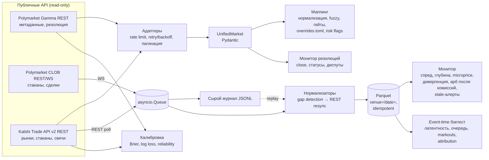

# prediction-markets-monitor

Инструмент для исследования и мониторинга prediction markets. Работает только на чтение. Приводит рынки Polymarket и Kalshi к единой схеме, сопоставляет эквивалентные контракты между площадками и помечает расхождения в правилах резолюции. Также записывает L2-стаканы в Parquet, считает спред, глубину, дивергенцию и арбитраж после комиссий, следит за жизненным циклом рынков и прогоняет event-time бэктест с моделью очереди и post-trade attribution.

**Стек:** Python 3.12, asyncio, httpx, websockets, Pydantic v2, PyArrow/Parquet (zstd), rapidfuzz, pytest, ruff, uv, GitHub Actions.

## Быстрый старт

```bash
uv sync
uv run pytest            # офлайн, на записанных фикстурах; live-тесты: uv run pytest -m live
uv run ruff check .

# Всё ниже работает на закоммиченном сэмпле (6 минут книг Chiefs–Dolphins с обеих площадок)
uv run pmmon monitor  --mapping data/sample/mapping_kcmia.json --store data/sample/books
uv run pmmon backtest --mapping data/sample/mapping_kcmia.json --store data/sample/books --strategy mm --mm-venue polymarket
uv run pmmon backtest --mapping data/sample/mapping_kcmia.json --store data/sample/books --strategy arb
uv run pmmon calibration --from-csv data/sample/calibration_24h.csv --tables
uv run pmmon record --from-journal data/sample/journal_kcmia.jsonl.gz --out data/books   # пересборка стора из сырого журнала

# Живой пайплайн (нужна сеть; публичные эндпоинты без авторизации)
uv run pmmon discover --pm-tag nfl --kalshi-series KXNFLGAME --moneyline-only --out data/markets.jsonl
uv run pmmon map --markets data/markets.jsonl --out data/mapping.json
uv run pmmon record --mapping data/mapping.json --duration 900 --journal data/journal.jsonl.gz --out data/books
uv run pmmon monitor --mapping data/mapping.json --resolution          # статусы/резолюции прямо сейчас
uv run pmmon calibration --venue both --horizon-h 24 --limit 300 --min-volume 50000 --since 2026-06-01 --csv data/calib.csv
```

## Архитектура



Модули в `src/pmmon/`: `venues/` (адаптеры), `models.py` (схема), `fees.py`, `http.py`, `book.py`, `mapping/`, `recorder/` (journal, normalise, sink, recorder), `monitor/` (metrics, alerts, replay), `backtest/` (engine, strategies), `bayes.py`, `calibration.py`, `cli.py`.

## Единая схема

Единица схемы — один бинарный контракт: токен исхода на Polymarket или тикер рынка на Kalshi. Все цены записаны в вероятностных единицах [0, 1] для стороны YES этого контракта.

| Поле | Polymarket | Kalshi |
|---|---|---|
| `venue`, `market_id` | `polymarket`, CLOB token id | `kalshi`, market ticker |
| `parent_id`, `event_id`, `event_title` | conditionId, event id / title | ticker, event_ticker / title |
| `question`, `outcome` | question, outcome токена | title, `yes_sub_title` |
| `contract_type` | `binary` | `binary` |
| `status` | active/closed/acceptingOrders + `umaResolutionStatus` → open / paused / closed / proposed / disputed / resolved | initialized/active/closed/determined/disputed/finalized → те же значения |
| `best_bid`, `best_ask`, `last_price` | Gamma (для второго токена зеркалится 1 − p) | `*_dollars` (или legacy центы / 100) |
| `tick_size`, `min_order_size` | `orderPriceMinTickSize`, `orderMinSize` | `price_ranges[].step` |
| `fees` | `feeSchedule`: `C·rate·(p(1−p))^exp`, округление до 1e-5, мейкер 0 | серия `fee_type`/`fee_multiplier`: `ceil_cent(0.07·C·p(1−p))`, мейкер 0.0175 для `quadratic_with_maker_fees` |
| `close_time`, `expected_resolution_time` | `endDate` | `close_time`, `expected_expiration_time` |
| `resolution_source`, `rules_text` | `resolutionSource`, `description` | `settlement_sources` события/серии, `rules_primary` + `rules_secondary` |
| `result` | `outcomePrices` после резолюции | `result` yes/no/scalar |

Нормализованная строка стакана (`BookRow`, Parquet): `venue, market_id, ts_ms, recv_ts_ms, seq, kind (snapshot|delta|trade), side, price, size, event_id`. Дельта хранит абсолютный размер уровня, а не приращение, поэтому повторное применение ничего не ломает. Ключ идемпотентности: `(venue, market_id, event_id, kind, side, price)`.

## Ключевые решения

- **Сначала журнал, потом нормализация.** Каждое входящее сообщение дописывается в JSONL (можно с gzip) до обработки. Parquet-стор полностью пересобирается командой `record --from-journal`. Ресинки тоже идут через журнал, поэтому replay воспроизводит их в точности.
- **Идемпотентная запись.** Sink подгружает ключи уже существующих файлов партиции и отбрасывает дубликаты. Имя файла содержит content hash, файл пишется через tmp и атомарный rename. Повторный ingest того же журнала пишет 0 строк (проверено тестом и на полной записи).
- **Gap detection без sequence numbers.** В market-канале Polymarket нет `seq`. Зато каждый `price_change` приносит `best_bid`/`best_ask` площадки после изменения. Если реконструированный top of book с ними не совпадает, считаем это разрывом, помечаем рынок и запрашиваем REST-снапшот `/book`. Для Kalshi WS (он требует API-ключ) реализован парсер с проверкой `seq != last + 1`. Для публичного режима Kalshi опрашивается по REST, и соседние снапшоты превращаются в дельты.
- **Синтетические снапшоты** пишутся раз в 5 минут, так что любой временной срез стора можно проиграть, не начиная с самого начала.
- **Маппинг строится на правилах, а не на эмбеддингах.** Алиасы сущностей (32 команды NFL, Fed, BTC/ETH), синонимы (hike→increase, «no change»→hold, oct→october) и нормализация чисел (`25 bps`, `>25bps`, `50+ bps`, `$100,000`). Жёсткие гейты: даты в пределах окна, совпадение числовых линий, противоположные направления (increase и decrease, over и under) исключены, для Yes/No-рынков маппится только YES-токен. Скор складывается из fuzzy token-set по событию и исходу, Jaccard по сущностям и близости дат. Дальше жадное one-to-one назначение и ручные `[[pair]]`/`[[block]]` в `config/overrides.toml`. Для каждой пары вычисляются risk flags: разные источники резолюции, разные дедлайны, разная формулировка правил (tie, 50-50, fair price, postpone, void и т. п.), разный тик.
- **Арбитраж считается по стакану, а не по top of book.** Обе ноги прогоняются через глубину, берётся общий исполнимый объём, вычитаются комиссии обеих площадок и буфер проскальзывания.
- **Модель исполнения в бэктесте.**
  - IOC исполняется по книге в момент прибытия, то есть после латентности конкретной площадки.
  - Пассивная заявка встаёт в конец очереди. Принты сделок сначала съедают `queue_ahead`. Необъяснённое уменьшение уровня считается отменами, которые распределены по очереди pro-rata. Для Kalshi без принтов часть уменьшения считается скрытыми сделками (`hidden_trade_share`).
  - Пробой цены даёт полный филл.
  - Для площадок, записанных REST-опросом, IOC исполняется только на ликвидность, которая пережила окно подтверждения (3 с ≈ интервал опроса). Без этого устаревший снапшот создаёт фантомные филлы.
- **Attribution сходится точно.** `total = spread_capture + inventory_pnl − fees`, где спред меряется от последнего маркированного mid, а инвентарная часть равна позиции, умноженной на последующие изменения mid. Невязка равна 0 (проверяется тестами).
- **Калибровка.** Для каждого разрешённого рынка берётся цена за H часов до закрытия: у Kalshi это mid свечи, у Polymarket — `prices-history`. Из неё считаются Brier, log loss, разложение Мерфи, ECE и таблица надёжности. Мультивариантные комбо Kalshi (`KXMVE*`) и резолюции 50-50 исключены.

## Результаты (живые данные, 27.09.2026)

Все числа ниже получены на реальных данных, записанных во время дневного слейта NFL (игры шли в эфире). Большой стор в репозиторий не коммитится. В `data/sample/` лежит 6-минутный срез по одной паре и собранный CSV калибровки.

**Запись.** 17:36–17:56 UTC, 9 матчей, 18 токенов Polymarket (WS) и 18 тикеров Kalshi (REST, в среднем около 3 с на цикл):
- 455 766 WS-сообщений и 3 564 опроса Kalshi дали 1 125 034 нормализованные строки.
- Сырой JSON весит 327 МБ, Parquet с zstd — 29 МБ.
- Площадка прислала 3 947 строк-дубликатов (0,35 %), они отсеяны. Повторный ingest записал 0 строк (1 128 981 отброшена как дубль).
- 308 расхождений top of book (0,07 % сообщений) закрыты следующим `book`-сообщением площадки или REST-ресинком.

Отдельно команда `pmmon record` отработала вживую 15 минут:
- 326 284 WS-сообщения по 28 парам;
- 1 разрыв WS с автоматическим переподключением;
- несколько HTTP 429 от Kalshi, отработанных backoff'ом;
- 259 расхождений и 259 ресинков.

**Маппинг** (`discover --moneyline-only` → `map`): из 1 998 контрактов Polymarket и 62 Kalshi получилось 36 пар moneyline с confidence от 0,96 до 1,00. Ручная проверка ошибок не нашла. Все пары помечены двумя risk flags:
- `close_time_differs(48h)`: Kalshi держит рынок открытым до 48 ч после матча;
- `rule_terms_differ`: у Polymarket отмена матча или ничья ведут к резолюции 50-50, у Kalshi игра, не начавшаяся в течение 48 ч, резолвится по «fair price».

На рынках решения ФРС (октябрь 2026) пары 25 bps и «no change» сопоставились автоматически. Пары «50+ bps» и «>25bps» числовой гейт отклонил, и они закреплены через `overrides.toml`.

**Монитор** (18 пар с данными, размер 100 контрактов):

| Метрика | Значение |
|---|---|
| Средняя абсолютная дивергенция mid между площадками | 0,47¢ (по парам от 0,23¢ до 0,76¢) |
| Медиана p95 дивергенции | 1,75¢ |
| Эпизоды с положительным арбом после комиссий | 123 |
| Медианная длительность эпизода | ≈ 2,2 с |
| Максимальный net на 100 контрактов | $8,32 |

Длительность эпизодов сопоставима с интервалом опроса Kalshi. Поэтому значимая часть эпизодов, скорее всего, возникает из-за устаревшего снапшота, а не из-за реальной исполнимой цены.

**Бэктест кросс-площадочного арбитража** (149 попыток, 100 контрактов на ногу, min edge 0,5¢):

| Модель исполнения | Обе ноги | Одна нога | Незахеджировано | Locked P&L* | MTM P&L |
|---|---|---|---|---|---|
| Наивная: 0 мс, без окна подтверждения | 149 | 0 | 0 | $306,65 | $276,65 |
| Консервативная: PM 250 мс, Kalshi 150 мс + 3 с подтверждения | 49 | 100 | 9 603 контр. | $117,56 | −$58,28 (комиссии $78,55) |

\* Locked P&L предполагает, что обе площадки разрешат рынок одинаково. Именно этот риск и помечают флаги маппинга.

Главный вывод: результат определяется моделью исполнения. Наивный бэктест показывает стабильную прибыль, а при реалистичной латентности и REST-данных Kalshi остаются в основном одноногие позиции.

**Бэктест пассивного маркет-мейкинга** (Polymarket, 18 токенов, котировка 100, max inventory 1 000, skew 2¢):
- 4 829 котировок и 159 филлов: quote fill rate 3,2 %, объём 13 358 контрактов, максимальный инвентарь 723.
- Attribution: spread capture −$68,21 (в среднем −0,51¢ к mid), инвентарь −$77,35, комиссии $0 (у NFL-рынков на момент записи `feeType: zero_fees`), итого −$145,57.
- Markout на 1 / 10 / 60 с: −1,60 / −1,64 / −1,98¢. Adverse selection: 1,09 / 1,12 / 1,47¢ на контракт.

Вывод: на стакане со спредом в 1 тик во время live-матча наивное котирование у touch проигрывает информированному потоку.

**Калибровка** (цена за 24 ч до закрытия, рынки закрыты после 01.06.2026, объём ≥ 50k):

| Площадка | n | Brier | Log loss | ECE |
|---|---|---|---|---|
| Polymarket | 300 | 0,116 | 0,335 | 0,058 |
| Kalshi | 56 | 0,209 | 0,617 | 0,118 |
| Всего | 356 | 0,131 | 0,379 | 0,057 |

Оговорки к таблице:
- 134 из 300 точек Polymarket попадают в бин 0–0,1: это аутсайдеры мультиисходных событий, и они улучшают Brier.
- Выборка Kalshi мала, потому что у многих рынков нет свечей за 24 ч до закрытия (например, у 15-минутных).
- Сравнивать площадки напрямую некорректно: состав рынков разный.

## Ограничения

- **Это исследовательский и операционный инструмент. Исполнения ордеров нет:** используются только публичные GET-эндпоинты и публичный WS market-канал, ключи и торговые API не используются.
- **Проверьте доступность Polymarket и Kalshi в своей юрисдикции** до любого практического использования. Часть рынков помечена площадкой как `restricted`.
- **Риск изменений API.** Схемы уже менялись: у Kalshi центы сменились на `*_dollars` и `*_fp`, у Polymarket изменился формат `price_change` и появился `feeSchedule`. Парсеры поддерживают старый и новый форматы там, где это известно, но поля могут поменяться снова. Ответы в `tests/fixtures/` записаны 27.09.2026.
- Kalshi без API-ключа доступен только через REST-опрос (около 3 с на цикл для 18 рынков), без принтов сделок. Из-за этого пассивные филлы там моделируются через `hidden_trade_share`, а IOC — через окно подтверждения. Обе величины — допущения, а не наблюдения.
- Бэктест не моделирует рыночное влияние: реплей-стакан не уменьшается от наших сделок, объём ограничен только видимой глубиной. Также не моделируются риск резолюции (оба рынка считаются разрешёнными одинаково), капитал и маржа, rebates Polymarket.
- Формула комиссии Kalshi (`0.07·C·p(1−p)` для тейкера и `0.0175` для мейкера) не сверена с актуальным официальным fee schedule: при сборке PDF был недоступен. Перед использованием чисел проверьте коэффициенты в `fees.py`.
- Комиссия по VWAP считается как одна сделка, хотя по уровням стакана она может отличаться на округлении.
- Маппинг рассчитан на форматы, которые встречались на практике (спорт, ФРС). Для новых категорий нужно расширять `aliases.toml` и синонимы или добавлять overrides.
- Калибровка использует историю цен (у Polymarket это last trade или mid с часовой гранулярностью), а не цену исполнимой стороны.

## Как это соотносится с вакансией

| Требование (prediction markets trader / quant developer / backend engineer markets) | Где в проекте |
|---|---|
| Python, асинхронные WebSocket/REST-интеграции | `venues/`, `http.py`, `recorder/recorder.py`: rate limit, retry с `Retry-After`, пагинация, PING/PONG, реконнект |
| Idempotent pipelines | журнал → нормализатор → Parquet с дедупом и атомарной записью; replay журнала воспроизводит результат |
| Tick-data backtesting | `backtest/engine.py`: event-time реплей, латентность, модель очереди, markouts, attribution |
| Bayesian methods | `bayes.py`: Beta-binomial, log-odds updating с темперированием, калибровка |
| Market resolution | единые статусы, `ResolutionMonitor` (close, переходы статусов, диспуты, 50-50), risk flags правил в маппинге |
| Cross-platform arbitrage, market making | `monitor/metrics.py`, `strategies.py`: арб после комиссий и проскальзывания по глубине, MM с inventory skew |
| Работа с Polymarket и Kalshi | реальные ответы API в фикстурах, живая запись и числа выше |

## Лицензия

MIT, см. [LICENSE](LICENSE).
